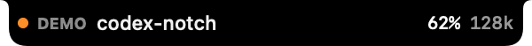
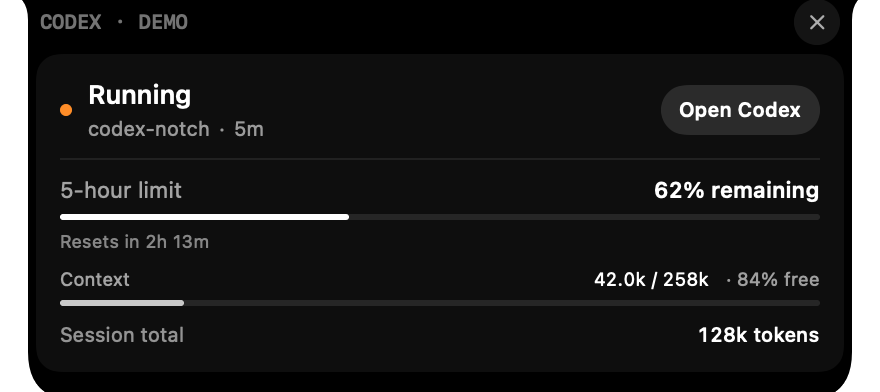
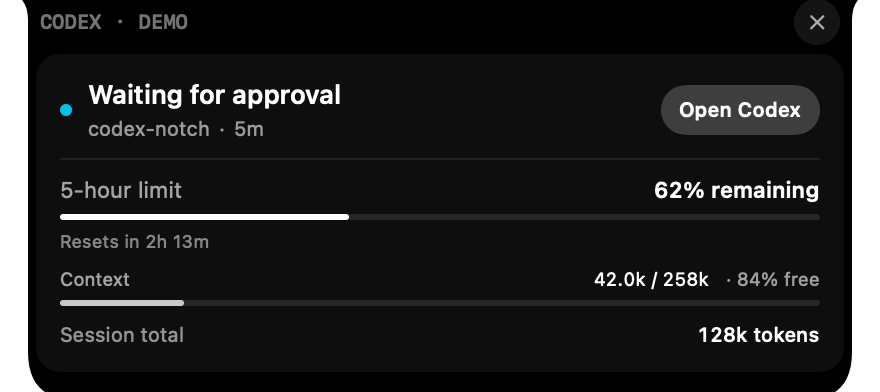
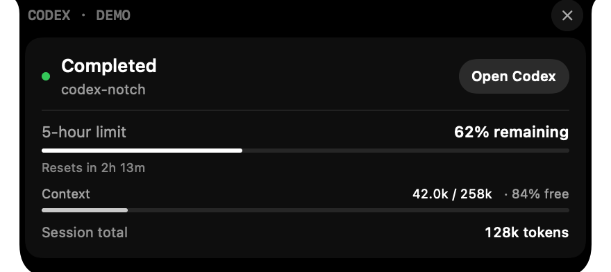
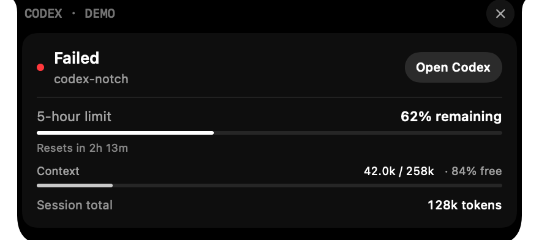
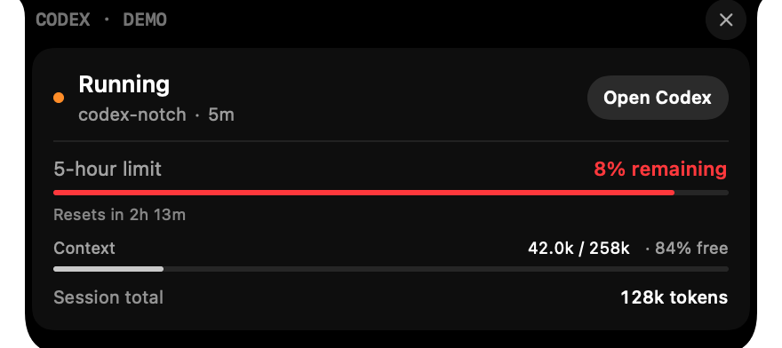

<div align="center">

# Codex Notch

**Your Codex session, at a glance.**<br>
A native macOS dashboard that lives at the top of your screen.

[简体中文](README.zh-CN.md) · English



</div>

Codex Notch keeps the current session's status, usage limit and context in view while you work. Hover over the island to see details; click it to keep the panel open.

> Unofficial community project. Not affiliated with or endorsed by OpenAI.

## See it in action

These images are rendered from the actual app UI with **demo data**. They show the simulated island on a display without a physical notch; they are not photographs of a MacBook screen or live account data.

| Running | Waiting for approval |
| :--- | :--- |
|  |  |
| See the session, remaining quota, reset time and context at a glance. | A cyan indicator signals that attention is needed. Open Codex to respond. |

| Completed | Failed |
| :--- | :--- |
|  |  |
| A green indicator marks the end of a turn. | A red indicator flags a failure. |

**Running low on quota** — the remaining percentage turns red once 90% of the window has been used.



The waiting state requires a supported approval event; the island does not approve commands. Completed and failed states are temporary and eventually disappear when not expanded or pinned.

## At a glance

- **Status:** running, waiting, completed or failed.
- **Quota:** remaining percentage and reset countdown for the available window.
- **Context:** used tokens and estimated remaining capacity.
- **Session total:** cumulative tokens across the session, not just the current turn.
- **Interaction:** hover to expand, click to pin, and use **×** to close. On displays without a physical notch, the simulated island sits at the screen's top edge.

## Requirements and installation

- macOS 14 or later, with Codex already installed and used at least once.
- Xcode Command Line Tools and Swift for building from source.

```bash
git clone https://github.com/github-bian/codex-notch.git
cd codex-notch
./scripts/install.sh
open "$HOME/Applications/CodexNotch.app"
```

The installer replaces an existing `~/Applications/CodexNotch.app`. The local build uses an ad-hoc signature and is not notarized; macOS may show a security warning.

## Usage and data

Normal mode reads local rollout files under `~/.codex/sessions`. It follows the file most recently written, checks for updates every second, and searches for a newer session approximately every five seconds. When several sessions are active, the most recently written file is not necessarily the session currently in the foreground.

The app shows one quota window reported by Codex. Its duration is taken from the data, so it may be five hours, seven days, or another duration. Quota and context sections are hidden when their data is unavailable. Total tokens are cumulative for the session, not just the current turn. The elapsed time is shown when a start time is available; an old inactive session is not treated as live.

The menu bar icon offers **Open Codex**, **Copy hook config**, **Reveal data folder**, and **Quit**. The app does not claim to jump to a particular session.

### Optional: event notifications

Polling works without configuration. To forward supported Codex notifications, copy the hook configuration from the menu bar and add it to `~/.codex/config.toml`, for example:

```toml
notify = ["/Users/<you>/Applications/CodexNotch.app/Contents/MacOS/codexnotch-hook"]
```

Restart Codex after changing its configuration. `notify` support varies by Codex version; in particular, an approval-waiting state requires an actual supported approval event to reach the hook. Codex Notch does not approve commands.

## Demo and diagnostics

```bash
.build/debug/CodexNotch --demo   # Explicitly simulated data, marked DEMO
.build/debug/CodexNotch --probe  # Display geometry and data locations
```

Build the debug executable with `swift build --disable-sandbox` first. The demo is isolated from live session and hook data. The probe prints local paths; review its output before sharing it.

## Privacy and limits

- Rollouts are read locally. The app does not read `~/.codex/auth.json`, upload data, or make network requests. Opening `codex://` asks macOS to open Codex.
- New hook events persist only the event type, thread and turn IDs, and working directory; prompt and response bodies are not saved. Older versions wrote the raw notification to `~/Library/Application Support/CodexNotch/events.jsonl`; upgrading does not delete that file.
- Startup examines a bounded recent portion of the latest rollout. Very long turns may not have their original start time in that portion, in which case elapsed time cannot be recovered reliably.
- Physical-notch geometry, multiple displays, focus behavior, and VoiceOver still require validation on the relevant hardware. `--probe` can help inspect screen geometry.

## Development

```bash
./scripts/test.sh        # Build and run the executable test suite
./scripts/build-app.sh   # Build build/CodexNotch.app
```

Pure parsing, formatting, and geometry live in `Sources/CodexNotchCore`; the native panel and UI live in `Sources/CodexNotch`. The optional hook is a separate executable.

## License

[MIT](LICENSE). The notch interaction is inspired by community projects including BoringNotch, AgentNotch, and Code Island.
