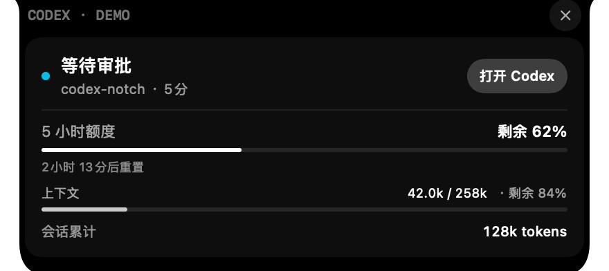
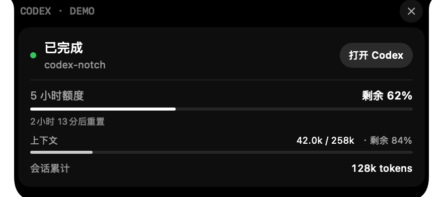
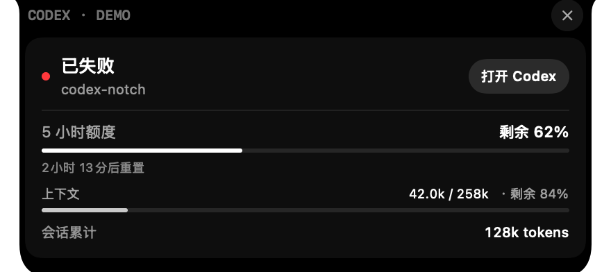
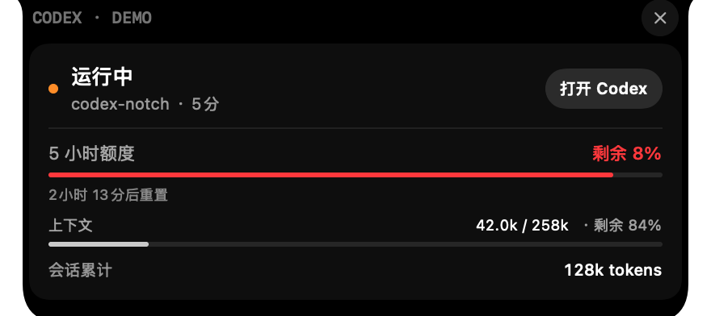
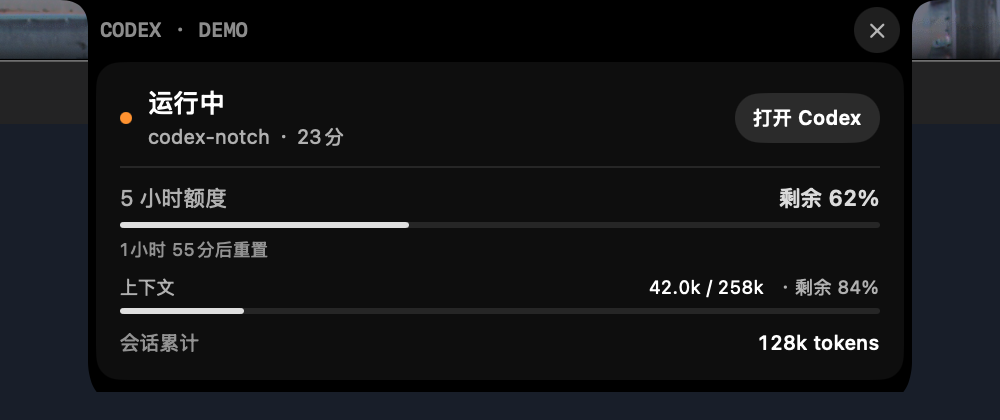
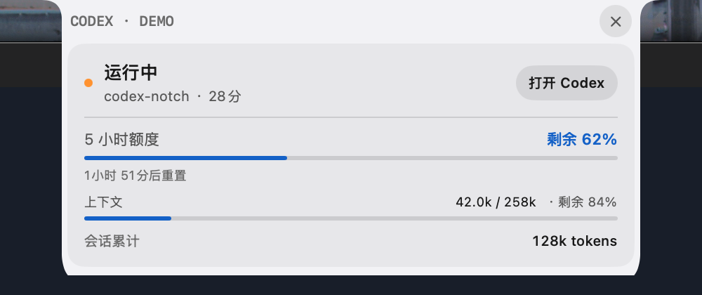
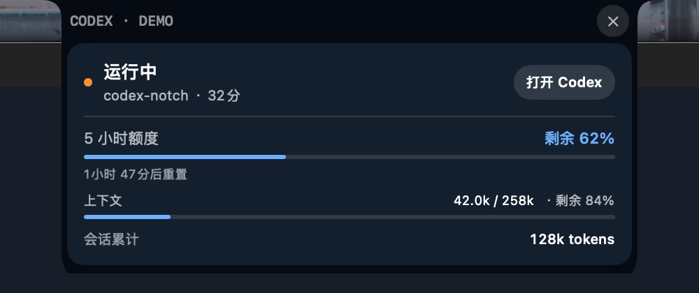
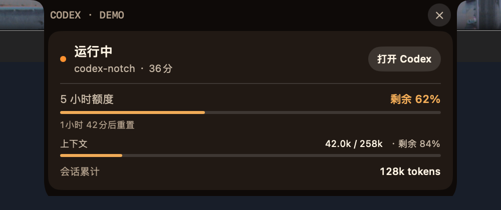

<div align="center">

# Codex Notch

**抬眼之间，了解 Codex 的进度。**<br>
一个贴合屏幕顶边的原生 macOS 仪表盘。

简体中文 · [English](README.md)


</div>

工作时，Codex Notch 帮你留意当前会话、额度和上下文。鼠标移到岛面即可查看详情；点击收起态，可以钉住展开的面板。

> 非官方社区项目，与 OpenAI 没有隶属或背书关系。

## 看看实际界面

以下图片由**应用真实界面渲染**，使用演示数据，展示的是无物理刘海显示器上的模拟岛面；不是 MacBook 实机照片，也不是账号的实时用量。

| 运行中 | 等待审批 |
| :--- | :--- |
|  |  |
| 一眼查看项目、剩余额度、重置时间和上下文。 | 青色状态点提示需要处理；打开 Codex 后响应。 |

| 已完成 | 已失败 |
| :--- | :--- |
|  |  |
| 绿色状态点表示回合结束。 | 红色状态点提示回合失败。 |

**额度紧张**：当窗口额度已使用 90% 时，剩余百分比变红。



等待审批需要收到受支持的审批事件，岛面不会替你批准命令。完成与失败状态在面板未展开或钉住时会短暂显示后消失。

## 选择主题

四种主题适配不同的桌面偏好。以下是应用运行时使用演示数据的截图，拍摄于没有物理刘海的外接显示器。

| 曜石 | 月光 |
| :--- | :--- |
|  |  |
| 深海 | 琥珀 |
|  |  |

1. 点击 macOS 菜单栏中的 Codex Notch 图标。
2. 打开**主题**，选择**曜石、月光、深海或琥珀**。
3. 选择**跟随系统**时，深色模式使用曜石，浅色模式使用月光。应用会记住你的选择。

## 一眼能看到什么

- **状态**：运行中、等待审批、已完成或已失败。
- **额度**：可用窗口的剩余百分比与重置倒计时。
- **上下文**：已用 Token 与估算剩余空间。
- **会话累计**：整个会话累计的 Token，并非当前回合单独消耗。
- **操作**：悬停展开、点击钉住，点击 **×** 收起；无物理刘海的显示器也会在屏幕顶边显示模拟岛面。

## 环境与安装

- macOS 14 或更新版本，已安装并至少使用过一次 Codex。
- 从源码构建需要 Xcode Command Line Tools 和 Swift。

```bash
git clone https://github.com/github-bian/codex-notch.git
cd codex-notch
./scripts/install.sh
open "$HOME/Applications/CodexNotch.app"
```

安装脚本会替换已有的 `~/Applications/CodexNotch.app`。本地构建使用临时签名、尚未公证，macOS 可能显示安全提示。

## 使用与数据口径

正常模式读取 `~/.codex/sessions` 下的本地会话文件：每秒检查增量，约每 5 秒查找最近写入的会话。多个会话同时运行时，最近写入的会话不一定是当前前台会话。

应用展示 Codex 返回的一个额度窗口，窗口长度由数据决定，可能是 5 小时、7 天或其他时长。额度或上下文数据缺失时，相应区域会隐藏。Token 是**整个会话的累计值**，不是当前回合单独消耗的数量。可取得开始时间时显示运行时长；长期未更新的会话不会一直显示运行中。

菜单栏图标提供**打开 Codex、复制 hook 配置、显示数据文件夹和退出**。当前版本打开 Codex，但不保证跳转到特定会话。

### 可选：配置事件通知

不配置也能通过轮询使用。若要转发 Codex 支持的通知，可从菜单栏复制 hook 配置，加入 `~/.codex/config.toml`，例如：

```toml
notify = ["/Users/<you>/Applications/CodexNotch.app/Contents/MacOS/codexnotch-hook"]
```

修改配置后重启 Codex。不同 Codex 版本提供的 `notify` 事件可能不同；尤其是等待审批状态，需要对应的审批事件实际到达 hook。Codex Notch 不会替用户批准命令。

## 演示与诊断

```bash
.build/debug/CodexNotch --demo   # 明确标记 DEMO 的模拟数据
.build/debug/CodexNotch --probe  # 显示屏幕几何和数据位置
```

先用 `swift build --disable-sandbox` 构建调试版本。演示模式不接入真实会话或 hook 数据。`--probe` 会输出本地路径，分享前请自行检查。

## 隐私与已知限制

- 会话文件只在本机读取；不读取 `~/.codex/auth.json`、不上传数据、不主动联网。打开 `codex://` 会交给 macOS 启动 Codex。
- 新写入的 hook 事件只包含事件类型、会话与回合 ID、工作目录，不保存提示词和回答正文。旧版本曾把原始通知写入 `~/Library/Application Support/CodexNotch/events.jsonl`；升级不会删除该文件。
- 启动时只扫描最新会话末尾的有限数据。特别长的回合可能无法恢复原始开始时间，因此无法可靠显示运行时长。
- 物理刘海、多显示器、键盘焦点和 VoiceOver 仍需在对应设备上验证；可用 `--probe` 查看屏幕几何。

## 开发

```bash
./scripts/test.sh        # 构建并运行可执行测试
./scripts/build-app.sh   # 构建 build/CodexNotch.app
```

解析、格式化和几何逻辑位于 `Sources/CodexNotchCore`，原生窗口与界面位于 `Sources/CodexNotch`，可选 hook 是独立可执行文件。

## 许可证

[MIT](LICENSE)。刘海交互参考了 BoringNotch、AgentNotch、Code Island 等社区项目。
